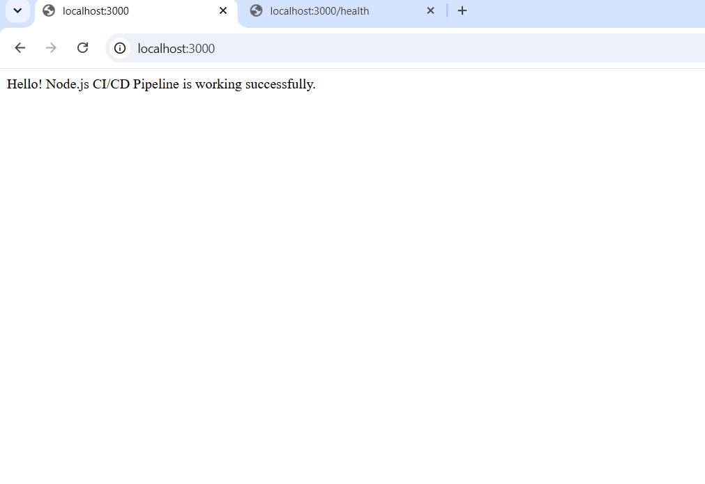
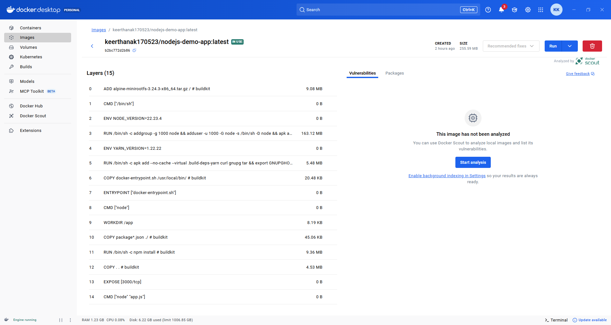
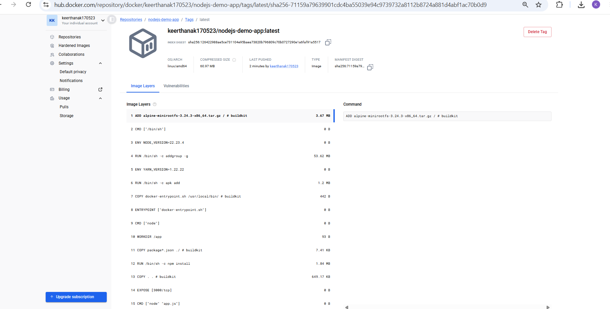

# Node.js CI/CD Pipeline Using GitHub Actions and Docker

**Internship Task:** Automate Code Deployment Using CI/CD Pipeline
(GitHub Actions)\
**GitHub Repository:**
https://github.com/KeerthanaKkeeru/nodejs-demo-app\
**Docker Hub Image:** `keerthanak170523/nodejs-demo-app:latest`

## 1. Project Overview

This project demonstrates a basic CI/CD pipeline for a Node.js web
application. GitHub Actions runs automated tests and, when the tests
pass, builds a Docker image and pushes it to Docker Hub.

## 2. Technologies Used

-   **Node.js** --- runtime for the web application
-   **Express.js** --- HTTP server and routes
-   **Node.js test runner** --- automated application tests
-   **Git and GitHub** --- source-code version control
-   **GitHub Actions** --- CI/CD workflow automation
-   **Docker** --- packages the application into an image and container
-   **Docker Hub** --- stores the published Docker image

## 3. Application Endpoints

The application provides these endpoints:

-   `/` --- displays a success message.
-   `/health` --- returns a JSON health status.

### Home page



### Health endpoint


## 4. CI/CD Workflow

The workflow file is located at `.github/workflows/main.yml`. It is
configured to run when code is pushed to the `main` branch and can also
be started manually using `workflow_dispatch`.

The pipeline has two jobs:

1.  **Test Node.js Application**
    -   Checks out the repository.
    -   Sets up Node.js.
    -   Installs dependencies with `npm ci`.
    -   Runs automated tests with `npm test`.
2.  **Build and Push Docker Image**
    -   Runs only after the test job succeeds.
    -   Configures Docker Buildx.
    -   Logs in to Docker Hub using GitHub Actions repository secrets.
    -   Builds the Docker image and pushes the `latest` tag.

The Docker Hub credentials are stored in GitHub repository secrets named
`DOCKERHUB_USERNAME` and `DOCKERHUB_TOKEN`. The token itself is not
included in this repository.

## 5. Docker Build and Container Verification

The Docker image was built locally and the application was run in a
container. The screenshots below show the local Docker image, container,
image layers, and container logs.

### Local Docker images


### Running container


### Image list including the tagged project image


### Docker image layers



### Container logs


## 6. Docker Hub Image

The image is published to Docker Hub with the following name and tag:

``` text
keerthanak170523/nodejs-demo-app:latest
```

Docker Hub repository:
https://hub.docker.com/r/keerthanak170523/nodejs-demo-app

### Published `latest` tag



### Docker Hub repository overview


## 7. CI/CD Result

The GitHub Actions workflow completed successfully. Both jobs showed a
successful status:

-   Test Node.js Application
-   Build and Push Docker Image

This confirms that the automated tests passed and the workflow completed
the Docker build-and-push job. The local browser screenshots also show
the home page and health endpoint responding as expected.

GitHub Actions run history:
https://github.com/KeerthanaKkeeru/nodejs-demo-app/actions

## 8. Useful Commands

Install dependencies:

``` bash
npm ci
```

Run tests:

``` bash
npm test
```

Start the application locally:

``` bash
npm start
```

Build the Docker image:

``` bash
docker build -t keerthanak170523/nodejs-demo-app:latest .
```

Run the container:

``` bash
docker run -d -p 3000:3000 --name nodejs-demo keerthanak170523/nodejs-demo-app:latest
```

Push the image to Docker Hub:

``` bash
docker push keerthanak170523/nodejs-demo-app:latest
```

## 9. Conclusion

This task demonstrates how to automate testing, Docker image creation,
and Docker Hub publishing using GitHub Actions. The source code,
workflow configuration, README, and supporting screenshots are included
in the GitHub project.

------------------------------------------------------------------------

**Note:** The screenshots in the `screenshots/` folder are linked using
relative paths. Keep the folder alongside this `README.md` file so the
images display correctly on GitHub.
